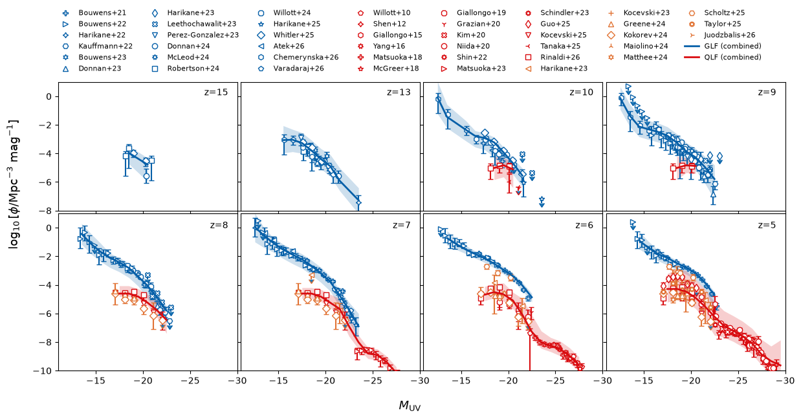
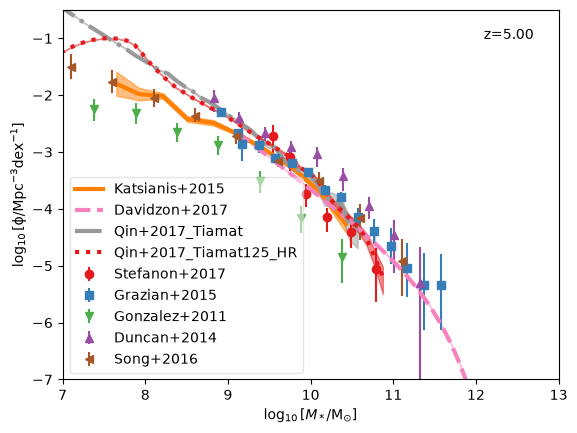

AstroDataPy
===========

.. image:: https://github.com/qyx268/astrodatapy/actions/workflows/tests.yml/badge.svg
    :target: https://github.com/qyx268/astrodatapy/actions/workflows/tests.yml
    :alt: Tests

.. image:: https://readthedocs.org/projects/astrodatapy/badge/?version=latest
    :target: https://astrodatapy.readthedocs.io/en/latest/
    :alt: Documentation

Python tools to collect astronomical data.

This is a python package dedicated to collect up-to-date astronomical 
data from both observational and modelling campaigns, with a focus on 
galaxy properties. Current package includes 1) statistical properties
such as the number densities of galaxies (as functions of stellar mass,
UV magnitude, [OIII] luminosity and star formation rate) and AGN (as functions
of black hole mass and quasar UV/optical/bolometric/X-ray luminosities);
2) correlations between galaxy properties such as the Magorrian relation,
Tully Fisher relation, disk size - stellar mass relation and halo - stellar
mass relation; and 3) clustering of quasars such as the two point
correlation function. Every dataset is converted to common units and to the
Hubble parameter you ask for.

UV luminosity functions of galaxies (blue) and AGN (red) at z = 5-15 in
astrodatapy, with the combined constraints made by
`combine.ipynb <https://github.com/qyx268/astrodatapy/blob/master/astrodatapy/utils/combine.ipynb>`__.

Installation
============

astrodatapy needs Python 3.6 or later, with numpy and pandas.

.. code-block:: console

    $ pip install astrodatapy

On Python 3.6 and 3.7, upgrade pip first (``pip install --upgrade pip``).
To also get what the example notebooks need (matplotlib, scipy, astropy
and Jupyter):

.. code-block:: console

    $ pip install "astrodatapy[notebooks]"

For the latest version on GitHub, which may have data not yet released:

.. code-block:: console

    $ pip install git+https://github.com/qyx268/astrodatapy

Tests
-----

The tests load every dataset and execute the example notebooks:

.. code-block:: console

    $ pip install "astrodatapy[test,notebooks]"
    $ pytest --pyargs astrodatapy

Without the ``notebooks`` extra, the notebook tests are skipped.

Usage
=====

Each of the three classes, ``number_density``, ``correlation`` and
``clustering``, takes a feature name (see `Features`_) and a target redshift,
and loads every dataset of that feature with a data file within ``z_tol``
(default 0.25) of it:

.. code:: python

    from astrodatapy.number_density import number_density
    obs = number_density(feature='GLF_UV', z_target=7.0, h=0.6774, quiet=True)

The other arguments are ``h``, the Hubble parameter H0/(100 km/s/Mpc) to
convert the data to (default 1); ``quiet``, to stop it printing what it loads
and converts; and, for ``number_density`` and ``correlation``, ``IMF_out``, the
IMF to convert stellar masses and star formation rates to (``Salpeter``,
``DietSalpeter``, ``Kroupa`` or ``Chabrier``; default ``Kroupa``).

The datasets found are in ``obs.target_observation``, a pandas DataFrame indexed
by dataset name, with columns:

* ``DataType``: ``data``, ``data_sim`` (a model), or the parametric fit it was
  evaluated from (e.g. ``Schechter``);
* ``FileName``: the data file loaded;
* ``Data``: a numpy array. For ``number_density`` its columns are x, phi, and the
  upper and lower bound of phi, with phi linear in Mpc^-3 dex^-1 (Mpc^-3 mag^-1
  for magnitudes); in the rows that are upper limits all three phi columns hold
  the limit. BHM is
  the exception: its columns are the redshift, the black hole mass in Msun
  (linear) and its upper and lower bound. For ``correlation`` the columns are x,
  the upper and lower bound of x, y, and the upper and lower bound of y;
* ``ULimit`` (``number_density``): a boolean array marking the rows of ``Data``
  that are upper limits;
* ``BinWidth`` (``number_density``): an array with the width of each row's bin in
  the units of x (dex or mag). Most existing datasets don't record their bin widths
  yet, so it is ``nan`` for them; new datasets should give them, and older ones can be
  updated over time.

``number_density`` rescales phi as h^3, stellar masses, star formation rates
and luminosities as h^-2, magnitudes by 5 log10(h/h_obs), and black hole masses
according to how they were measured. ``correlation`` rescales each quantity
with the power of h given for its dataset (e.g. h^-2 for stellar masses, h^-1
for sizes and halo masses, none for velocities and ratios), and ``clustering``
the correlation length. See the
`data format <https://github.com/qyx268/astrodatapy/blob/master/astrodatapy/data/README.rst>`__
for details.

Example 1
---------
read the quasar two point correlation function at z = 4 with a redshift range of [3.5, 4.5]

.. code:: python

    >>> import numpy as np
    >>> from astrodatapy.clustering import clustering
    >>> obs = clustering(feature = 'QC_2PTCF', z_target = 4.0, z_tol = 0.5)
    You are requesting QC_2PTCF at z_target=4.00 with a tolerance of z_tol=0.50 and h=1.000
    quiet=True to silent
    available data of QC_2PTCF includes:
    Shen2007 Shen2009 He2018 Eftekharzadeh2015 Chehade2016 Retana-Montenegro2016

    Loading observational data from He2018...
    Filename .../site-packages/astrodatapy/data//QC_2PTCF/z3pt8.dat
    ..done
    >>> # show all available data of QC_2PTCF
    >>> list(obs.available_observation)
    ['Shen2007', 'Shen2009', 'He2018', 'Eftekharzadeh2015', 'Chehade2016', 'Retana-Montenegro2016']
    >>> # show the redshifts of all available data of QC_2PTCF
    >>> np.sort(obs.z_available_observation)
    array([0.6, 1.5, 2.5, 3.2, 3.8, 4.5])
    >>> # show the target data of QC_2PTCF at z = 4
    >>> obs.target_observation[['DataType', 'FileName']]
                        DataType   FileName
    Name
    He2018  PowerLaw_2COMPONENTS  z3pt8.dat

Example 2
---------
read the UV luminosity function at z = 7, converted to h = 0.6774, without printing information

.. code:: python

    >>> from astrodatapy.number_density import number_density
    >>> obs = number_density(feature = 'GLF_UV', z_target = 7.0, h = 0.6774, quiet = True)
    >>> print(obs.n_target_observation)
    14
    >>> # M1600, phi, upper and lower bound of phi of Bouwens et al. (2021)
    >>> obs.target_observation.loc['Bouwens2021', 'Data'][:3]
    array([[-2.22612642e+01,  9.06236306e-07,  2.71870892e-06, -9.06236306e-07],
           [-2.17612642e+01,  3.71556885e-05,  4.71242879e-05,  2.71870892e-05],
           [-2.12612642e+01,  4.25931064e-05,  5.61866509e-05,  2.89995618e-05]])

Example 3
---------
plot the galaxy stellar mass function at redshift 5 and show labels

.. code:: python

    import numpy as np
    import matplotlib.pyplot as plt
    from astrodatapy.number_density import number_density

    colors     = ['#e41a1c','#377eb8','#4daf4a','#984ea3','#ff7f00','#a65628','#f781bf','#999999'] * 4
    markers    = ['o','s','v','^','<','>','p','*','D','.','8'] * 4
    linestyles = ['-','--','-.',':']

    z   = 5.0
    obs = number_density(feature='GSMF', z_target=z, quiet=True, h=0.678)

    j_data = 0
    k_func = 0
    fig, ax = plt.subplots(1, 1)
    for ii in range(obs.n_target_observation):
        data      = obs.target_observation['Data'].iloc[ii]
        label     = obs.target_observation.index[ii]
        datatype  = obs.target_observation['DataType'].iloc[ii]
        color     = colors[ii]
        marker    = markers[j_data]
        linestyle = linestyles[k_func]
        data[:,1:] = np.log10(data[:,1:])
        if datatype == 'data':
            ul = obs.target_observation['ULimit'].iloc[ii]  # rows that are upper limits
            ax.errorbar(data[~ul,0], data[~ul,1], yerr=[data[~ul,1]-data[~ul,3], data[~ul,2]-data[~ul,1]],
                        label=label, color=color, fmt=marker)
            if ul.any():
                ax.errorbar(data[ul,0], data[ul,1], yerr=0.2*np.abs(data[ul,1]), uplims=True,
                            color=color, fmt=marker)
            j_data += 1
        else:
            ax.plot(data[:,0], data[:,1], label=label, color=color, linestyle=linestyle, lw=3)
            ax.fill_between(data[:,0], data[:,2], data[:,3], color=color, alpha=0.5)
            k_func += 1

    ax.set_xlim(7, 13)
    ax.set_ylim(-7, -0.5)
    ax.text(0.95, 0.95, "z=%.2f" % z, horizontalalignment='right',
            verticalalignment='top', transform=ax.transAxes)
    leg = ax.legend(loc='lower left')
    leg.get_frame().set_alpha(0.5)
    ax.set_xlabel(r"$\log_{10}[M_*/{\rm M_{\odot}}]$")
    ax.set_ylabel(r"$\log_{10}[\rm \phi/Mpc^{-3} dex^{-1}]$")
    plt.savefig('./GSMF.png', bbox_inches='tight')

More examples can be found in `this jupyter notebook <https://github.com/qyx268/astrodatapy/blob/master/astrodatapy/utils/plots.ipynb>`_.
`combine.ipynb <https://github.com/qyx268/astrodatapy/blob/master/astrodatapy/utils/combine.ipynb>`_
shows how different datasets are combined into one empirical constraint
(for GLF_UV, QLF_UV and GLF_OIII).

Documentation
=============

https://astrodatapy.readthedocs.io, including a list of every dataset with its
redshifts and reference.

Features
========

Number density
--------------

==============  =========================================  ======================================
**Features**    **Descriptions**                           **x**
--------------  -----------------------------------------  --------------------------------------
BHM             Black Hole Mass                            redshift (y is the black hole mass)
BHMF            Black Hole Mass Function                   log10(M_BH/Msun)
GLF_UV          Galaxy Luminosity Function -- UV           M1600 or M1500 (AB)
GLF_OIII        Galaxy Luminosity Function -- [OIII] 5008  log10(L[OIII]/erg s^-1)
GSMF            Galaxy Stellar Mass Function -- all        log10(M*/Msun)
GSMF_Blue       Galaxy Stellar Mass Function -- blue       log10(M*/Msun)
GSMF_Bulge      Galaxy Stellar Mass Function -- bulge      log10(M*/Msun)
GSMF_Disk       Galaxy Stellar Mass Function -- disk       log10(M*/Msun)
GSMF_Quiescent  Galaxy Stellar Mass Function -- quiescent  log10(M*/Msun)
GSMF_Red        Galaxy Stellar Mass Function -- red        log10(M*/Msun)
QLF_bolometric  Quasar Luminosity Function -- bolometric   log10(L_bol/Lsun)
QLF_optical     Quasar Luminosity Function -- optical      M_B
QLF_UV          Quasar Luminosity Function -- UV           M1450 or M1500 (AB)
QLF_Xray        Quasar Luminosity Function -- X-ray        log10(L_X/erg s^-1), rest 2-10 keV
SFRF            Star Formation Rate Function               log10(SFR/Msun yr^-1)
==============  =========================================  ======================================

phi is per dex, or per magnitude when x is a magnitude.

Correlation
-----------

=========================  ================================================
**Features**               **Descriptions**
-------------------------  ------------------------------------------------
Magorrian                  Black Hole - Galaxy Bulge Mass Scaling Relation
Tully_Fisher               Mass - Velocity of Spiral Galaxies
DiskSize_StellarMass       DiskSize - StellarMass
GasFraction_StellarMass    GasFraction - StellarMass
sSFR_StellarMass_Blue      sSFR - StellarMass -- blue
HaloMass_StellarMass       HaloMass - StellarMass
HaloMass_StellarMass_Blue  HaloMass - StellarMass -- blue
HaloMass_StellarMass_Red   HaloMass - StellarMass -- red
=========================  ================================================

Clustering
----------

==============             =================================================
**Features**               **Descriptions**
--------------             -------------------------------------------------
QC_2PTCF                   Quasar Clustering -- 2 point correlation function
==============             =================================================

Adding data
===========

Each feature is a directory in ``astrodatapy/data`` with an ``info.txt`` that
lists its datasets, and one file per redshift for each dataset. The
`data format <https://github.com/qyx268/astrodatapy/blob/master/astrodatapy/data/README.rst>`__
describes these files, the units and the h conversions, and how to add a
dataset. Pull requests with new data are welcome.

License
=======

* Free software: BSD license

* This project is Copyright (c) Yuxiang Qin and licensed under the terms of the BSD 3-Clause license. See the licenses folder for more information.

Contributors
============

* Yuxiang Qin (The Australian National University)

with contributions from Balu Sreedhar, Fatma Shaban, Varun Nikam, Madeline
Marshall and Simon Mutch.
